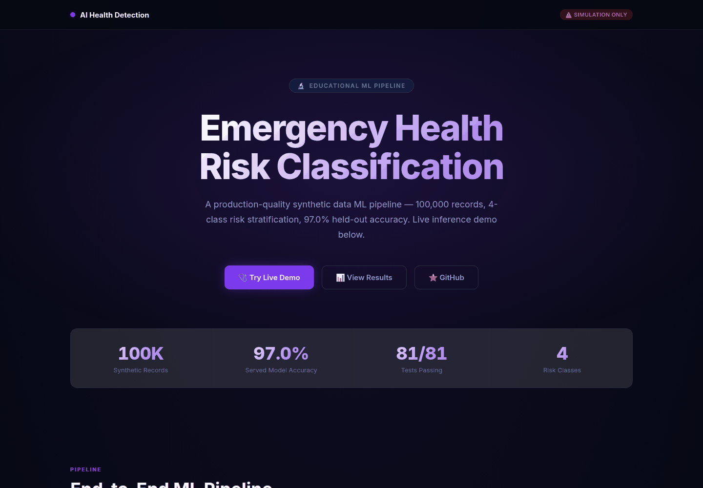
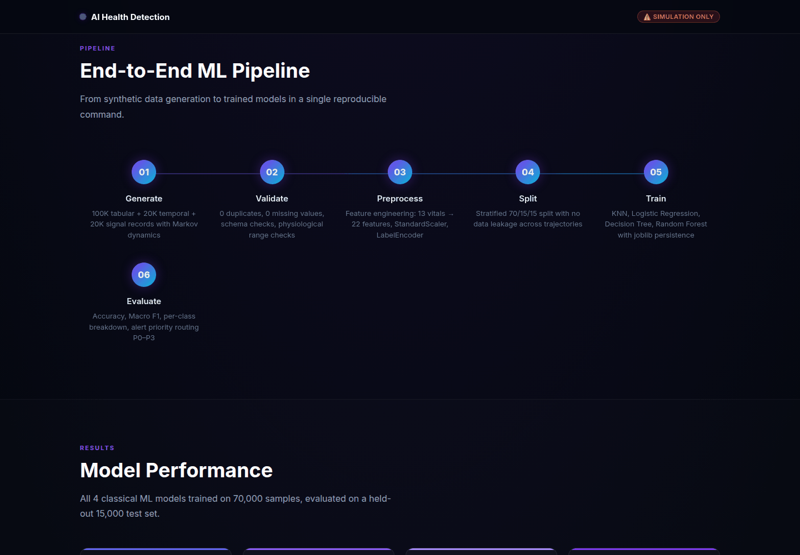
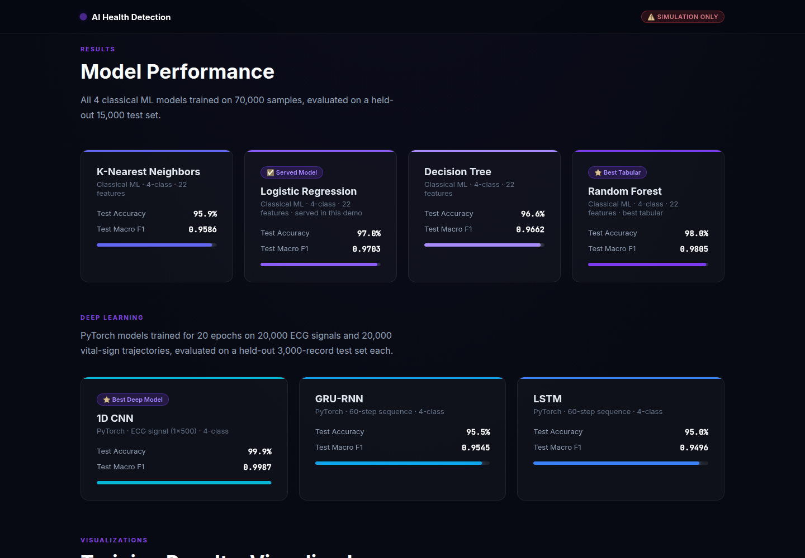
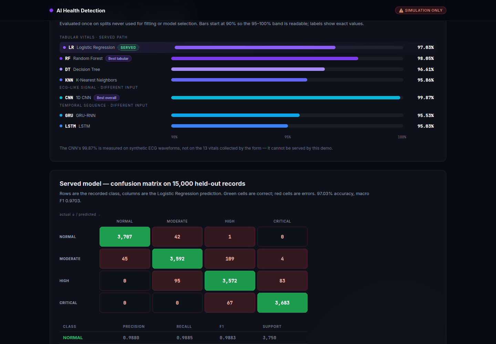
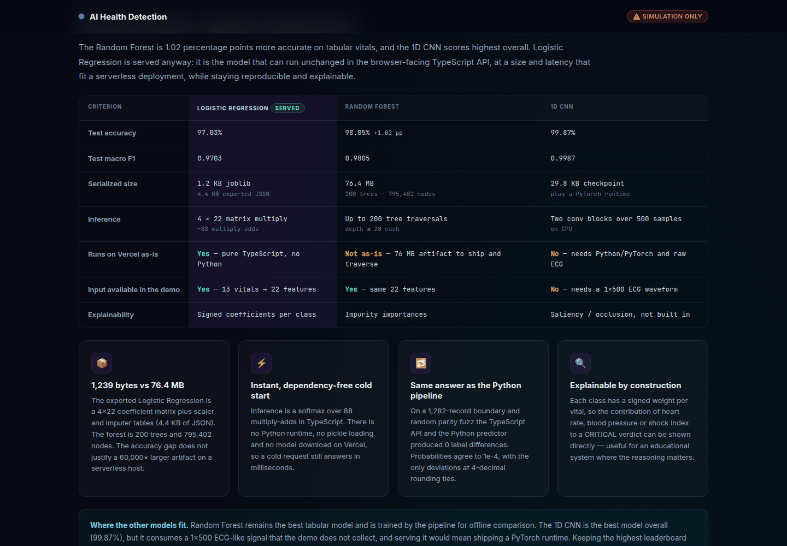
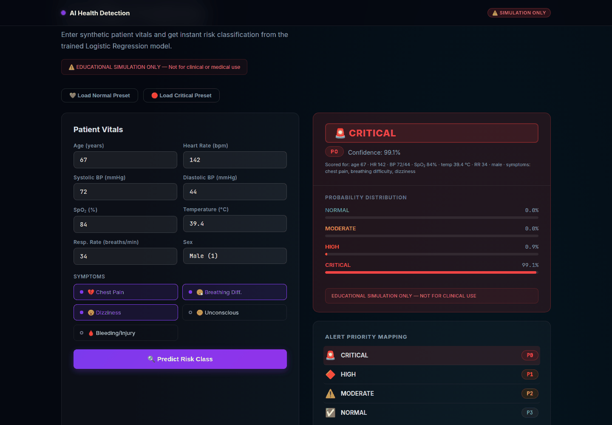
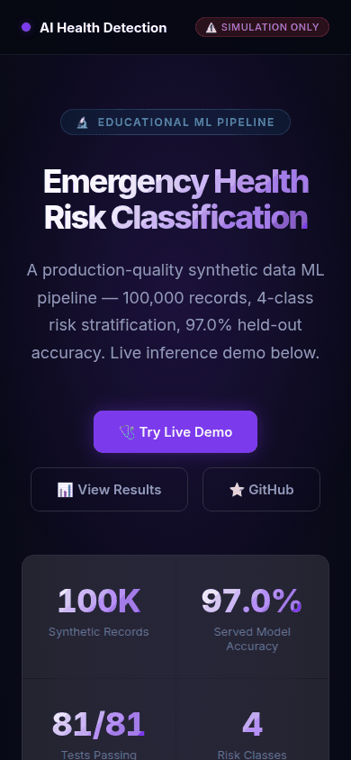

# AI-Based Emergency Health Detection and Alert System

**An educational, end-to-end machine-learning system that classifies synthetic patient
vitals into four emergency-risk levels and routes a simulated P0–P3 alert.**

Trained offline in Python on 100% synthetic data · served dependency-free on Vercel ·
fully reproducible with seed 42.

> [!IMPORTANT]
> **EDUCATIONAL SOFTWARE SIMULATION DISCLAIMER**
> This project is strictly an **educational software simulation** built on **fully
> synthetic data**. It is NOT a medical device. It does NOT provide diagnosis,
> treatment recommendations, clinical decisions, real sensor acquisition, ambulance
> dispatch, or hospital integration. No real patient data is used anywhere.

**Live demo:** <https://ai-emergency-health-assistant-kappa.vercel.app/>
**Technical design:** [`SYSTEMDESIGN.md`](SYSTEMDESIGN.md)
**Build status:** [`BUILD_STATUS.md`](BUILD_STATUS.md)
**Documentation index:** [`documentation/`](documentation/)

---

## 1. Team members

| Name | Enrollment No. |
|---|---|
| Anshul Sharma | BETN1AI25061 |
| Yuvraj Tayal | BETN1AI25101 |

---

## 2. Problem statement

Emergency triage is a genuinely hard ML problem: four risk levels, overlapping
symptoms, asymmetric costs, and no room for confident wrong answers. A model that is
99.9% sure a patient is fine when they are not is worse than no model at all. Real
patient data is private and regulated, so a student project cannot — and should not —
train on it.

This project asks a different question:

> **Can we build the entire lifecycle honestly — data, models, evaluation, serving —
> on fully synthetic data, and ship it as a public demo without faking any part of it?**

The problem addressed is therefore both clinical and engineering-shaped:

1. Turn a small set of vitals (heart rate, blood pressure, SpO₂, temperature,
   respiratory rate, age, sex, symptoms) into one of four risk classes.
2. Map the predicted class to an alert priority so the most urgent cases surface first.
3. Refuse implausible or malformed input instead of silently rounding it into a
   reassuring "normal" answer.
4. Serve the result from a public URL with no Python runtime, in milliseconds, with the
   training-time behaviour preserved exactly.

The goal was not "a model that predicts disease". It was **engineering proof**: a
reproducible pipeline, three clinical data modalities, seven trained models, a real
evaluation protocol, a safety-conscious inference path, and a deployment that a
reviewer can audit line by line.

---

## 3. Objectives and how each was met

| # | Objective | Target | Result |
|---|---|---|---|
| 1 | Synthetic data at research scale | 100K tabular, 20K temporal, 20K signals | ✅ 100,000 / 20,000 / 20,000 |
| 2 | Cover three modalities | Tabular, sequence, signal | ✅ Three generators, three model families |
| 3 | Train four classical models | KNN, LR, DT, RF | ✅ All trained, 22 features |
| 4 | Train three deep models | 1D CNN, GRU, LSTM | ✅ All trained, 20 epochs each |
| 5 | Strong tabular accuracy | ≥ 95% macro F1 | ✅ 98.05% (RF), 97.03% (LR) |
| 6 | Strong signal accuracy | ≥ 99% | ✅ 99.87% (1D CNN) |
| 7 | Reproducibility | Deterministic reruns | ✅ Seed 42; retraining reproduced every metric |
| 8 | Test coverage | 100% passing | ✅ 81/81 |
| 9 | Deployable without Python | Zero runtime ML dependencies | ✅ 4.4 KB frozen parameters + TypeScript |
| 10 | Serving parity | No drift from Python | ✅ 15,000 held-out rows: 0 label diffs; 5/60,000 probability cells differ by 1e-4 (float32 rounding ties) |
| 11 | Safety guardrails | Reject implausible input | ✅ Range validation, explicit units, disclaimers |
| 12 | Honest documentation | Decisions and limits written down | ✅ README + SYSTEMDESIGN + BUILD_STATUS + report |

---

## 4. Technologies and tools used

| Layer | Technology | Why it is used here |
|---|---|---|
| Language | **Python 3.11+** | Generators, preprocessing, training, evaluation, inference |
| Numerics | **NumPy**, **pandas**, **SciPy** | Array/table operations, waveform synthesis, distributions |
| Classical ML | **scikit-learn** | KNN, Logistic Regression, Decision Tree, Random Forest, scaling, imputation, splits, metrics |
| Deep learning | **PyTorch** (CPU) | 1D CNN, 2-layer GRU, 2-layer LSTM training loops with DataLoaders |
| Persistence | **joblib**, **JSON** | Model checkpoints; frozen parameters for the web runtime |
| Config | **PyYAML** | One `config.yaml` for seed, splits, paths, hyperparameters |
| Explainability | **SHAP** (offline) | Feature-attribution analysis |
| Plotting | **Matplotlib**, **Seaborn** | Offline experiment figures |
| Testing | **pytest** | 81 automated tests over data, preprocessing, training, inference, alerts |
| Web | **Next.js 16** (App Router, React 19, TypeScript) | Home screen, live demo, `/api/predict`, `/api/metrics` |
| Styling | Hand-written CSS (no framework) | Dark clinical theme, responsive layout |
| Charts | Custom React + SVG/CSS | Accuracy bars, confusion-matrix heatmap, training curves — no chart dependency |
| Deployment | **Vercel** (Root Directory `web`) | Static page + two serverless functions, no Python at runtime |
| Containers | **Docker**, **docker compose** | One-command data + training + tests, reproducible environment |
| Tooling | Git, npm, Vercel CLI | Version control, dependency management, deploys |

---

## 5. Key features and functionalities

- **Three synthetic clinical modalities generated from scratch** — 100,000 tabular
  records, 20,000 temporal sequences, 20,000 ECG-like waveforms, all class-balanced and
  reproducible from seed 42.
- **22 leakage-free features** — 13 raw vitals plus 9 derived clinical features (pulse
  pressure, MAP, shock index, age band, SpO₂ severity band, four binary criteria).
- **Seven trained models with published metrics** — four classical (KNN, LR, DT, RF) and
  three deep (1D CNN, GRU, LSTM), all scored on held-out splits never used for fitting
  or model selection.
- **Live risk prediction** — an interactive vitals form with Normal/Critical presets
  returns the risk class, class probabilities, confidence and alert priority in one
  request.
- **Simulated P0–P3 alert routing** — CRITICAL → P0, HIGH → P1, MODERATE → P2,
  NORMAL → P3, each carrying an explicit "not for clinical use" disclaimer.
- **Server-side input hardening** — per-field range checks, strict type/format handling,
  a cross-field blood-pressure rule, optional Fahrenheit input, and `400` responses with
  a reason instead of silent defaults.
- **A red-flag constraint the model cannot break** — an unconscious patient can never be
  classified NORMAL or MODERATE.
- **Training-results visualisations on the home screen** — accuracy bars for all seven
  models, the served model's confusion matrix and per-class precision/recall/F1, deep
  learning training curves, and a written comparison explaining the model choice.
- **Two JSON APIs** — `POST /api/predict` for inference and `GET /api/metrics` for the
  published training results, both CORS-enabled and independently testable.
- **Reproducibility and parity** — fixed seed, frozen splits, an export guard, and a
  Python↔TypeScript parity check over the full test set and 1,282 raw records.
- **Automated verification** — 81 pytest tests plus a 160-check HTTP edge sweep covering
  boundaries, type confusion, concurrency and determinism.

---

## 6. System requirements

| Component | Requirement |
|---|---|
| OS | Linux, macOS or Windows (64-bit) |
| Python | 3.11 or newer (developed on 3.14) |
| RAM | 4 GB minimum; 8 GB recommended for deep training |
| Disk | ~1 GB free (85 MB datasets + 83 MB model artifacts + build caches) |
| Node.js | 20.9 or newer, with npm (only for the web demo) |
| Docker | Optional; Docker Engine 20+ with Compose for the one-command path |
| Browser | Any modern browser (Chrome, Edge, Firefox, Safari) |
| GPU | Not required — PyTorch runs on CPU |

No database server is required (see §9).

---

## 7. Installation instructions

```bash
# 1. Clone the repository
git clone https://github.com/anshulsharma200817-svg/ai-emergency_health_assistant.git
cd ai-emergency_health_assistant

# 2. Create and activate a virtual environment
python3 -m venv .venv
source .venv/bin/activate          # Windows: .venv\Scripts\activate

# 3. Install Python dependencies
pip install -r requirements.txt

# 4. (Optional) install the CPU-only PyTorch wheel — much smaller than the default
pip install torch --index-url https://download.pytorch.org/whl/cpu

# 5. Install web dependencies (only for the demo UI)
cd web && npm install && cd ..
```

The repository ships without generated data or trained models; they are git-ignored and
produced by the pipeline in step 1 of §8.

---

## 8. Steps to run the project

### 8.1 One command (data + training + tests)

```bash
docker compose up --build
```

Generates all synthetic data, trains the classical models, and runs the full test
suite; artifacts land in `data/`, `models/`, and `experiments/` on your machine.

### 8.2 Without Docker

```bash
# Generate the three synthetic datasets (~85 MB, about 40 s)
python3 generate_data.py

# Split, engineer features, scale, train the four classical models, evaluate
python3 run_pipeline.py --classical-only --skip-generate

# Run the automated test suite
python3 -m pytest tests -q
```

### 8.3 Deep models (optional, needs PyTorch)

```bash
python3 run_pipeline.py --deep-only --skip-generate
```

Trains the 1D CNN, GRU and LSTM for 20 epochs each with per-epoch train/validation
tracking and best-checkpoint saving. CPU-only; roughly 20 minutes for all three.

### 8.4 Web demo locally

```bash
cd web
npm run dev        # http://localhost:3000
# or a production build:
npm run build && npm start
```

### 8.5 Sweep the HTTP API end-to-end

```bash
python3 scripts/api_edge_check.py --base http://localhost:3000   # 160 checks
```

### 8.6 Call the API directly

```bash
curl -X POST https://your-app.vercel.app/api/predict \
  -H 'Content-Type: application/json' \
  -d '{"age":67,"heart_rate":142,"systolic_bp":72,"diastolic_bp":44,
       "spo2":84,"temperature":39.4,"respiratory_rate":34,
       "chest_pain":1,"breathing_difficulty":1,"dizziness":1}'
```

```json
{"predicted_risk_class":"CRITICAL","priority":"P0","confidence":0.9912,
 "probabilities":{"NORMAL":0,"MODERATE":0,"HIGH":0.0088,"CRITICAL":0.9912},
 "alert_color":"#ef4444",
 "disclaimer":"EDUCATIONAL SIMULATION ONLY — NOT FOR CLINICAL USE"}
```

`GET /api/metrics` returns the same numbers the home screen displays.

---

## 9. Database configuration

**Not applicable.** The project uses no database.

- Training data is generated into flat files (`data/raw/*.csv`, `data/processed/*.npy`).
- Models are persisted with `joblib` and exported to JSON under `web/lib/`.
- The deployed web app is stateless: it reads a committed 4.4 KB JSON parameter file and
  performs arithmetic in a serverless function. Nothing is stored per request, and there
  is no user account, session or history to persist.
- If persistence is ever needed, the two natural extensions are a PostgreSQL table for
  prediction audit logs and object storage for uploaded signals; both are listed as
  future work.

---

## 10. Screenshots of the working project

**Home screen** — the pipeline at a glance: 100K synthetic records, 97.03% served
accuracy, 7 models, 4 risk classes.



**Pipeline flow** — generate → validate → engineer → split → train → evaluate → serve.



**Model results** — all seven trained models with their held-out test metrics.



**Training-results visualisations** — accuracy bars for all seven models and the served
model's confusion matrix on 15,000 held-out records.



**Model choice** — the side-by-side comparison and the reasoning behind serving
Logistic Regression.



**Live prediction** — the Critical preset returning CRITICAL, P0, 99.1% confidence with
the full probability distribution.



**Mobile layout** — the same demo at 390 × 844, with no horizontal overflow.



A full-page capture is stored at
[`screenshots/08-home-full.png`](screenshots/08-home-full.png).

---

## 11. What we actually did

### 11.1 Generated three synthetic clinical datasets

Every modality is procedurally generated and class-balanced (25,000 per class for
tabular data; 5,000 per class for temporal sequences and signals):

| Modality | Method | Volume | Shape |
|---|---|---|---|
| **Tabular** | Scenario-based vitals + symptoms with bounded noise | 100,000 records | 14 raw columns → 22 features |
| **Temporal** | Markov latent-state trajectories | 20,000 sequences | (60 timesteps × 6 channels) |
| **Signal** | P/QRS/T ECG-like waveform synthesis at 500 Hz | 20,000 waveforms | (1 × 500) |

A validator then checks schema, ranges, duplicates and class balance before anything
is trained.

### 11.2 Engineered 22 features, with no leakage

Nine clinical features are derived on top of the 13 raw vitals: pulse pressure, mean
arterial pressure, shock index, age band, SpO₂ severity band, and four binary criteria
(tachycardia, hypotension, fever, tachypnea).

Splits are 70/15/15 and stratified; temporal splits are ID-based so a trajectory cannot
appear in two sets. Scaling and imputation are **fit on the training split only**.

### 11.3 Trained seven models

**Classical ML on tabular vitals**

| Model | Test Accuracy | Test Macro F1 |
|---|---|---|
| K-Nearest Neighbors (k=5) | 95.86% | 0.9586 |
| Logistic Regression | 97.03% | 0.9703 |
| Decision Tree (depth 10) | 96.61% | 0.9662 |
| **Random Forest** ⭐ | **98.05%** | **0.9805** |

**Deep learning in PyTorch**

| Model | Input | Test Accuracy | Test Macro F1 | Train time |
|---|---|---|---|---|
| **1D CNN** ⭐ | ECG signal (1×500) | **99.87%** | **0.9987** | 132 s |
| GRU (2-layer) | 60-step sequence | 95.53% | 0.9545 | 647 s |
| LSTM (2-layer) | 60-step sequence | 95.03% | 0.9496 | 481 s |

All seven were evaluated on held-out test splits that were never used for fitting or
model selection.

### 11.4 Built the inference and alert layer

`HealthRiskPredictor` performs single and batch inference; `SimulatedAlertEngine` maps
the predicted class to a priority and a simulated alert level:

| Risk | Priority | Simulated alert |
|---|---|---|
| CRITICAL | **P0** | `EMERGENCY_SIMULATION_CRITICAL` |
| HIGH | **P1** | `EMERGENCY_SIMULATION_HIGH` |
| MODERATE | **P2** | `SIMULATION_ADVISORY_MODERATE` |
| NORMAL | **P3** | `SIMULATION_STATUS_NORMAL` |

Every prediction carries an explicit "not for clinical use" disclaimer.

### 11.5 Shipped a live web demo

A Next.js 16 app in [`web/`](web) with an interactive vitals form, normal/critical
presets, per-model accuracy charts, the served model's confusion matrix, training
curves for the three deep models, and an explicit comparison explaining why Logistic
Regression is served over the higher-scoring alternatives.

The key engineering decision: **the trained scikit-learn model is frozen into a 4.4 KB
JSON file** (imputer medians, scaler mean/scale, a 4×22 coefficient matrix, 4
intercepts). `web/lib/inference.ts` reimplements the exact preprocessing and softmax
decision function in TypeScript. Vercel therefore runs **no Python, no pickle, no
PyTorch, and no model download** — just arithmetic with a negligible cold start.

Why Logistic Regression is served even though Random Forest scores 1.02 pp higher is
explained in [`SYSTEMDESIGN.md` §9](SYSTEMDESIGN.md#9-model-selection-for-serving). The
home screen presents the same reasoning next to the measured results, and
`scripts/export_web_training_results.py` regenerates every chart from the fitted
artifacts so the page cannot drift from the models it describes.

### 11.6 Hardened and verified it

- **Parity test, two layers:** the exported parameters reproduce scikit-learn on all
  **15,000** held-out rows (0 label differences, maximum probability difference
  `1.27 × 10⁻⁶`), and **1,282 raw records** (591 with `unconsciousness = 1`) sent through
  the HTTP API matched the Python pipeline with 0 label mismatches, 0 constraint
  mismatches and a maximum probability difference of `1 × 10⁻⁴` — only at 4-decimal
  rounding ties.
- **Input validation:** every vital is range-checked server-side; out-of-range input
  returns `400` with a per-field reason. Malformed values (`"abc"`, `"80abc"`, `"0x50"`,
  `"NaN"`, arrays, objects) are **rejected**, not quietly replaced by a healthy default —
  that was the most dangerous failure mode found, because a typo previously produced a
  confident `NORMAL` at 98.8%. Symptom flags accept `0/1`, `"0"/"1"` and booleans;
  `sex` is strictly `0`/`1`; and a strictly inverted blood pressure
  (`diastolic > systolic`) is refused. Fahrenheit is accepted explicitly via
  `temperature_unit: "F"`. The form validates against the same table and the same
  cross-field rule, so what the browser allows and what the API accepts cannot diverge.
- **No stale verdicts:** a displayed result is stamped with the values it was scored for
  and is discarded the moment any input changes — the panel can never show a confident
  answer beside vitals it never saw.
- **Extrapolation is labelled:** accepted ranges are wider than the training data (ages
  18–89, temperatures 30.5–44.49 °C), so inputs outside that support still score but come
  back with `distribution_warning` and an amber banner instead of being presented as
  ordinary results. The support bounds are **generated** from the training CSV by the
  export script rather than hand-copied, which is how the true temperature maximum was
  found to be 44.49 °C, not 44.5 °C.
- **Test isolation and export guard:** a test run previously overwrote the production
  joblibs with 200-sample models. Tests now write to a temp directory, and the export
  script verifies **before** writing: it refuses to publish parameters below **0.965**
  accuracy or from a held-out split smaller than **8,000** rows, leaving the committed
  JSON byte-identical. Both failure paths were tested for real (`--allow-small` is the
  explicit override).
- **Pipeline fails fast:** `run_pipeline.py` now aborts on an invalid schema, duplicate
  rows, missing values or out-of-range vitals instead of logging them and training
  anyway; `--skip-generate` errors cleanly when data is absent instead of silently
  generating 83 MB. A full classical retrain reproduces every metric exactly in ~100 s.
- **Alerting fails closed:** an unrecognised or missing risk class raises instead of
  defaulting to P3 "normal", so a label bug can never report the least-urgent tier.
- **Live checks:** page, all assets, both APIs, CORS preflight, hydration and mobile
  layout verified with headless Chrome; the mobile layout was fixed after a 40 px
  horizontal overflow in the training-results tables.

### 11.7 Deployed to Vercel

Root Directory `web`, no environment variables, no database. Deployment takes about
two minutes and is documented end-to-end in
[`SYSTEMDESIGN.md` §16](SYSTEMDESIGN.md#16-deployment-procedure).

---

## 12. Achievements at a glance

- **100,000 + 20,000 + 20,000** synthetic records across three modalities
- **7 models trained**: 4 classical, 3 deep — every metric published
- **99.87%** test accuracy on ECG-like signal classification (1D CNN)
- **98.05%** test accuracy and **0.9805** macro F1 on tabular triage (Random Forest)
- **81/81 tests passing**, isolated from production artifacts
- **0 label mismatches** between Python training and TypeScript serving; probabilities agree to 1.3 × 10⁻⁶ before rounding
- **4.4 KB** served model — no Python, pickle, ONNX or PyTorch at runtime
- **A real bug found and fixed during verification**: the deployed model had been
  accidentally replaced by a test artifact (92.05% instead of 97.03%), out-of-range
  input produced confident critical readings, and the result panel could display a
  verdict next to inputs that were never scored. All are now guarded against and
  documented.
- **160-check API edge sweep**: every numeric field at min−1/min/max/max+1, type
  confusion, Fahrenheit variants, malformed bodies, CORS, determinism under 48-way
  concurrency, the warning boundaries, and the unconsciousness red-flag constraint —
  all passing.
- **A red-flag invariant the model cannot break**: `unconsciousness` never appears in
  NORMAL or MODERATE in the training data, yet the logistic regression had learned a
  *positive* NORMAL weight for it, so ticking all five symptoms returned `NORMAL
  99.9%`. The serving layer now confines that record to HIGH/CRITICAL; it changes
  **0 of 15,000** test predictions, so accuracy stays exactly 97.03%.
- **Every claim is reproducible**: seed 42, fixed splits, regeneration and retraining
  reproduce the published numbers exactly.

---

## 13. What is in the repository

| Path | Contents |
|---|---|
| `src/` | Generators, validation, feature engineering, preprocessing, models, training, evaluation, explainability, inference, alert engine |
| `web/` | Next.js 16 demo, `/api/predict`, `/api/metrics`, TypeScript inference, frozen model params, training-results charts |
| `tests/` | 81 tests: 71 integration + 10 schema/config/import units |
| `scripts/` | `export_web_model_params.py` — re-export and verify the served model; `export_web_training_results.py` — refresh the home-screen charts from the latest artifacts; `api_edge_check.py` — 160-check HTTP sweep |
| `screenshots/` | Captured working-project screenshots used in this README |
| `documentation/` | Documentation index linking the design, status and architecture docs |
| `config.yaml` | Single source of truth: seed, splits, paths, hyperparameters |
| `data/`, `models/`, `experiments/` | Generated artifacts (git-ignored) |

Full file-by-file structure, architecture, and design rationale:
[`SYSTEMDESIGN.md`](SYSTEMDESIGN.md).

---

## 14. Scope and honest limitations

- **Synthetic data only.** The generators produce realistic *shapes*, not real
  physiology; results do not transfer to clinical use and are not meant to.
- **Not a medical device.** No diagnosis, treatment, dispatch, or device integration.
- **The deep models are not served.** They are trained and measured, but the web demo
  serves a tabular model because the form collects tabular vitals. The rationale is in
  `SYSTEMDESIGN.md` §9.
- **No authentication or rate limiting** on the public demo endpoints.
- **One data artifact:** 15 of 100,000 synthetic training rows have
  `diastolic == systolic` because one-decimal rounding collapsed a near-equal pair.
  The dataset is frozen so published metrics stay reproducible; the API accepts equality
  and rejects inversion (see `SYSTEMDESIGN.md` §3.1).
- **`backend/` and `frontend/`** in this repository are an unrelated auth demo and are
  excluded from deployment by the Vercel Root Directory setting.

---

## 15. Documentation map

| Document | Purpose |
|---|---|
| `README.md` (this file) | Problem, objectives, technologies, features, setup, screenshots, results |
| `SYSTEMDESIGN.md` | Architecture, data design, models, input→output pipeline, API contract, verification |
| `BUILD_STATUS.md` | Current completion status and model results |
| `architecture.md` | Visual overview of the training and serving planes |

---

## 16. Next steps

1. Serve the 1D CNN for ECG input as a separate demo (requires a model runtime or a
   second, signal-oriented form).
2. Add authentication and rate limiting before promoting the API publicly.
3. Extend explainability: surfaced SHAP values per prediction instead of offline-only.
4. Evaluate on a consented, de-identified dataset in a research setting — with IRB
   approval, and never as a medical device.

---

*Educational software simulation. All data is synthetic. Random seed: 42.
Not for clinical use.*
